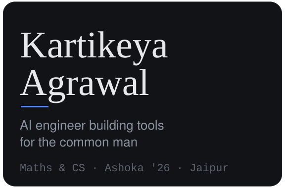
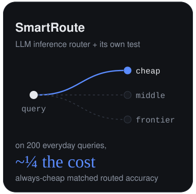
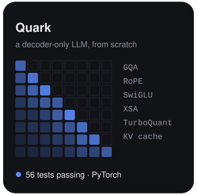
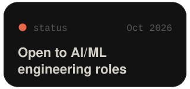
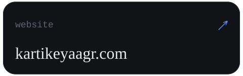
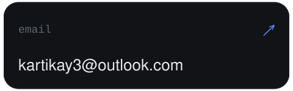

 
 
 
 

Most recently built the research desk for an Indian long-only fund (private).
Also: <a href="https://github.com/kartikeyaagr/Media-Bias-Analysis">Media Bias Analysis</a>, political lean and framing in Indian news. 
Khana Thali Vision trains on the <a href="https://arxiv.org/abs/2509.06006">Khana dataset</a> (arXiv:2509.06006) by Omkar Prabhu.

<!-- Owner: Kartikeya. Last reviewed: 24 Oct 2026.
Review when: starting a new role, publishing a new project, or sending a new
batch of applications.
Tiles are generated SVGs: edit assets/make_assets.py, then run
`python3 assets/make_assets.py assets`. Palette from kartikeyaagr.com. -->
