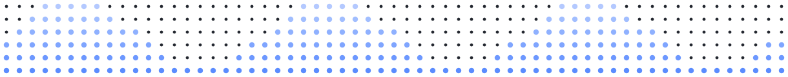

<a href="https://kartikeyaagr.com/?ref=github"></a>

<p align="center">
  <b>AI engineer building tools for the common man.</b><br>
  <sub>Maths &amp; CS, Ashoka University '26 · Jaipur, India</sub>
</p>

<p align="center">
  <a href="https://kartikeyaagr.com/?ref=github"></a>
  <a href="mailto:kartikay3@outlook.com"></a>
</p>

### about

```yaml
name:    Kartikeya Agrawal
role:    AI engineer, building tools for the common man
focus:   [computer vision, LLM infrastructure, local models]
studied: Maths & CS, Ashoka University ('26)
based:   Jaipur, India
recent:  built the research desk for an Indian long-only fund
status:  open to AI/ML engineering roles
motto:   benchmark it before you believe it
```

### work

<table>
  <tr>
    <td width="56" valign="top"><a href="https://github.com/kartikeyaagr/Khana-Thali-Vision"></a></td>
    <td valign="top">

**[Khana Thali Vision](https://github.com/kartikeyaagr/Khana-Thali-Vision)**\
Recognises the dishes on an Indian thali from a photo: a ConvNeXt classifier with
**95.78% top-1** on 80 dishes, YOLOv8n compartment detection, and top-down
correction for angled shots.\
`PyTorch` `timm` `YOLOv8` `OpenCV`

  </td>
  </tr>
  <tr>
    <td valign="top"><a href="https://github.com/kartikeyaagr/FinePrint"></a></td>
    <td valign="top">

**[FinePrint](https://github.com/kartikeyaagr/FinePrint)**\
A Chrome extension that summarises Terms &amp; Conditions in plain English, with a
1–10 security score and instant checks for **10 red-flag patterns**.\
`TypeScript` `React` `Chrome MV3`

  </td>
  </tr>
  <tr>
    <td valign="top"><a href="https://github.com/kartikeyaagr/SmartRoute"></a></td>
    <td valign="top">

**[SmartRoute](https://github.com/kartikeyaagr/SmartRoute)**\
An LLM router plus the harness that tests whether routing pays. On 200 everyday
queries, always using the cheapest model matched it at **about a quarter of the
cost**, so the README leads with that.\
`Python` `LLM inference` `benchmarking`

  </td>
  </tr>
  <tr>
    <td valign="top"><a href="https://github.com/kartikeyaagr/Quark"></a></td>
    <td valign="top">

**[Quark](https://github.com/kartikeyaagr/Quark)**\
A decoder-only language model **built from scratch** in PyTorch: grouped-query
attention, RoPE, SwiGLU and TurboQuant KV-cache compression. 56 tests passing.\
`PyTorch` `LLM architecture`

  </td>
  </tr>
  <tr>
    <td valign="top"><a href="https://github.com/kartikeyaagr/fast-laya-compaction"></a></td>
    <td valign="top">

**[fast-laya-compaction](https://github.com/kartikeyaagr/fast-laya-compaction)**\
Claude Code compaction that keeps the conversation word for word and trims stale
tool output instead, decided by a small model running locally. **27–33% smaller**
on real sessions.\
`TypeScript` `Claude Code` `local models`

  </td>
  </tr>
</table>

<sub>Also: <a href="https://github.com/kartikeyaagr/Media-Bias-Analysis">Media Bias Analysis</a>, political lean and framing in Indian news. Khana Thali Vision is trained on the <a href="https://arxiv.org/abs/2509.06006">Khana dataset</a> by Omkar Prabhu.</sub>

### stack

**ml** &nbsp;`PyTorch` `timm` `Ultralytics YOLO` `OpenCV` `scikit-learn` `MLflow`\
**build** &nbsp;`Python` `TypeScript` `React` `Chrome extensions` `uv`



<!-- Owner: Kartikeya. Last reviewed: 24 Oct 2026.
Review when: starting a new role, publishing a new project, or sending a new
batch of applications.
Images are generated dot-matrix SVGs: edit assets/make_assets.py, then run
`python3 assets/make_assets.py assets`. -->
